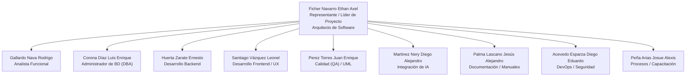
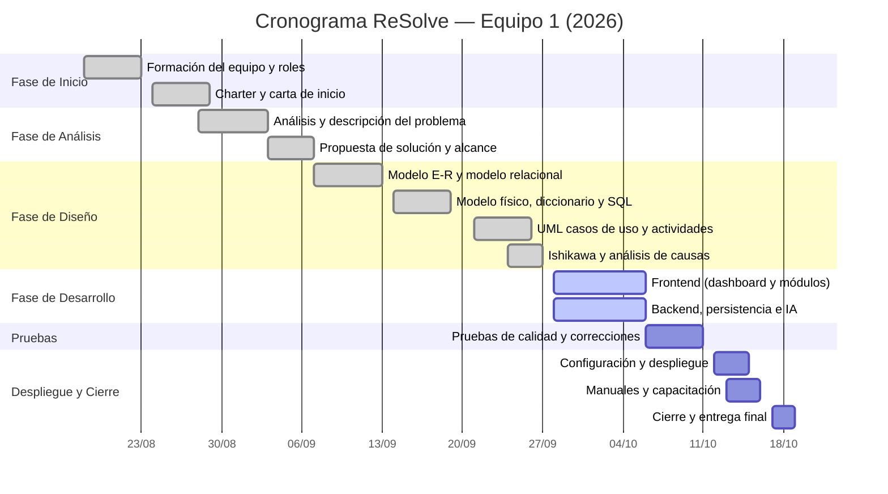
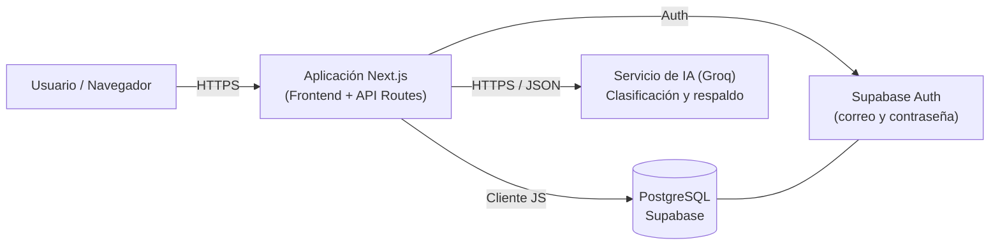
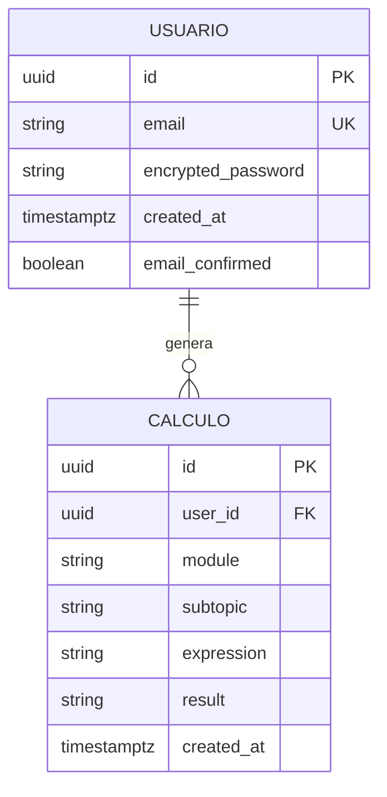
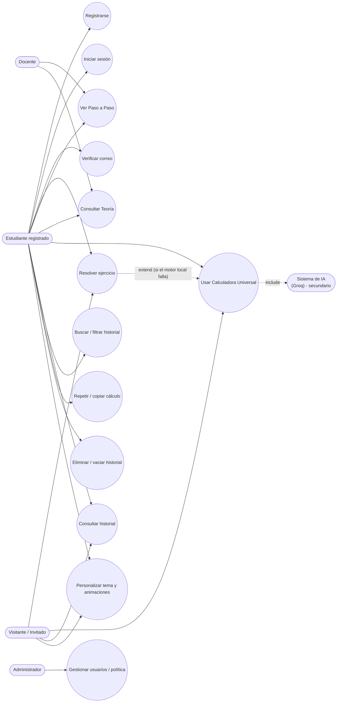
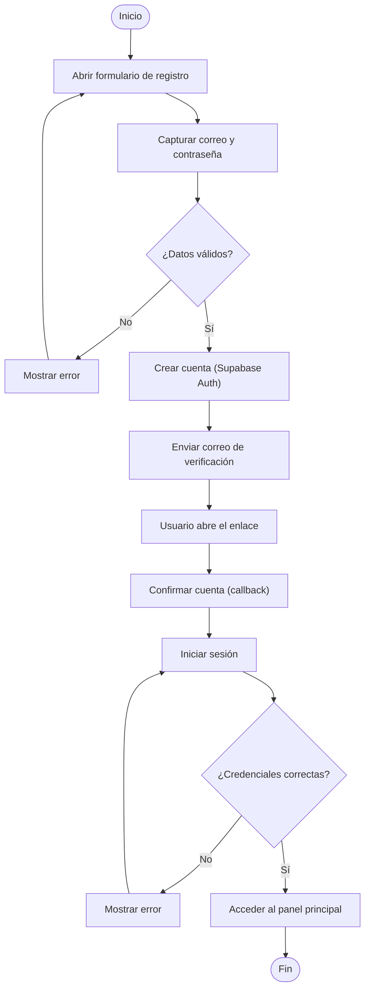
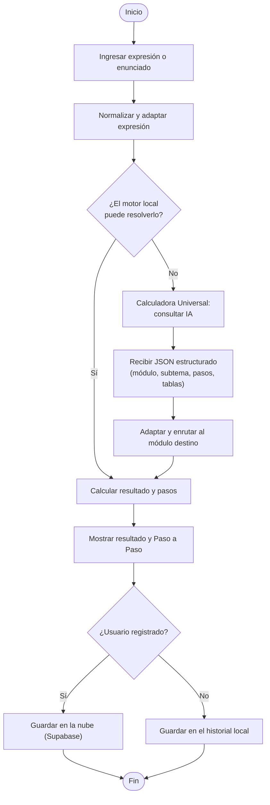
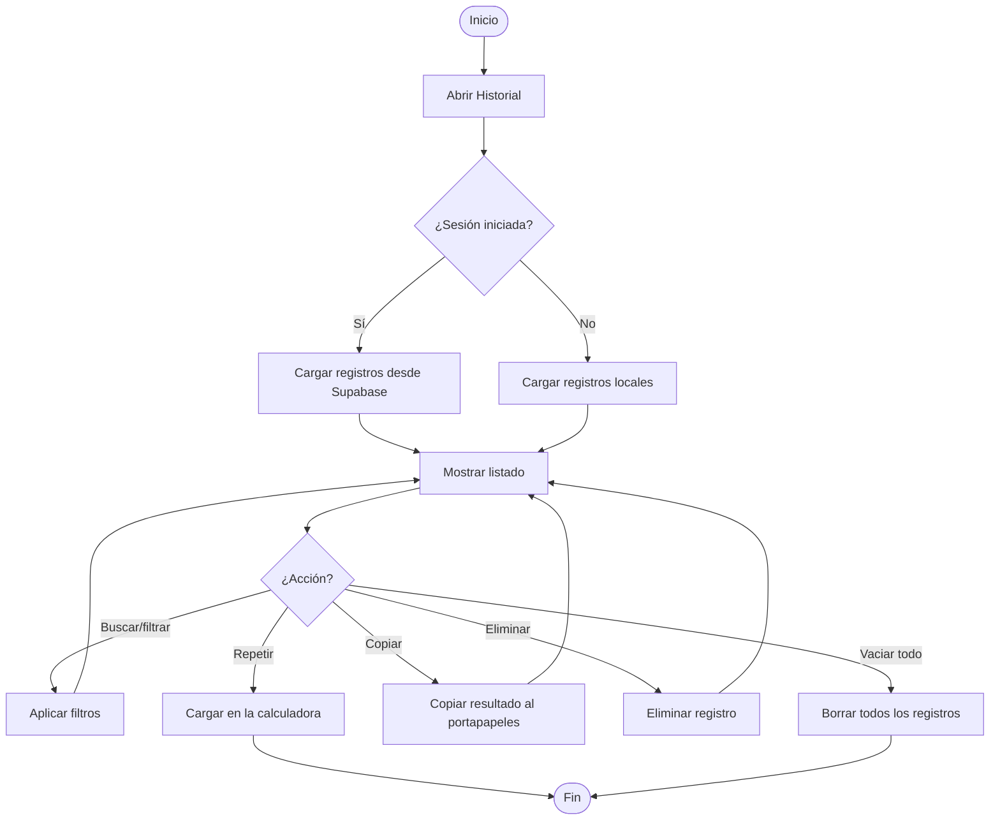
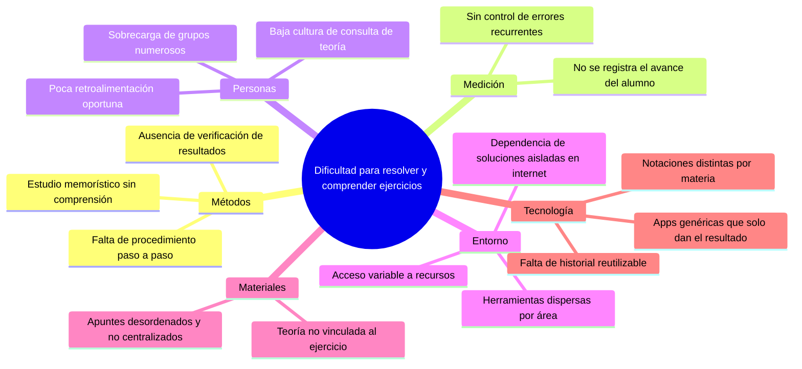
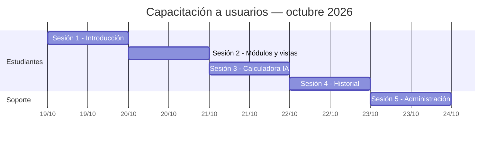

# PLAN DE TRABAJO · PROYECTO **ReSolve**

### Plataforma Analítica de Matemáticas Universitarias

---

**Asignatura:** Laboratorio de Sistemas de Información
**Equipo:** Equipo 1
**Proyecto:** ReSolve — Plataforma analítica de matemáticas universitarias
**Periodo:** Semestre Agosto – Octubre 2026
**Fecha de entrega:** 18 de octubre de 2026
**Versión del documento:** 1.0

> **Nota de edición (eliminar antes de imprimir):**
> Este documento está en formato Markdown listo para convertir a Word/PDF con Pandoc.
> Los diagramas se entregan en **Mermaid** (código) y con un **respaldo en texto/ASCII** para que se lean aunque no se rendericen.
> Sustituir los campos entre `[corchetes]` (p. ej. `[Nombre de la Institución]`) por los datos oficiales.
> Comando sugerido para exportar a Word:
> `pandoc docs/Plan_de_Trabajo_Equipo1.md -o Plan_de_Trabajo_Equipo1.docx --toc`
> Para incrustar los diagramas como imagen, renderizar los bloques Mermaid con `mmdc` (mermaid-cli) e insertarlos.

---

## 2. ÍNDICE

1. Portada
2. Índice
3. Formación de equipo y responsabilidades por integrante (organigrama)
4. Charter del proyecto
   - 4.1 Carta de inicio
5. Calendario de actividades (Gantt)
6. Análisis y descripción del problema
   - 6.1 Narrativa: descripción del proceso actual
   - 6.2 Planteamiento del problema
7. Propuesta de solución
   - 7.1 Narrativa: cómo resuelvo mi problema
   - 7.2 Alcance funcional (módulos del sistema)
8. Manual técnico
   - 8.1 Base de datos
     - 8.1.1 Modelo conceptual (Modelo E-R)
     - 8.1.2 Modelo lógico (Modelo relacional)
     - 8.1.3 Modelo físico (Diccionario de datos y código SQL)
   - 8.2 Diagramas UML
     - 8.2.1 Diagrama de casos de uso
     - 8.2.2 Diagramas de actividades
     - 8.2.3 Diagrama de Ishikawa
   - 8.3 Código
     - 8.3.1 Funciones
     - 8.3.2 Procedimientos
     - 8.3.3 Script
     - 8.3.4 Consultas (queries)
9. Manual administrativo
   - 9.1 Descripción del sistema
   - 9.2 Configuración: instalación y puesta a punto
   - 9.3 Privilegios de usuarios
   - 9.4 Políticas de funcionamiento
10. Manual de usuario
    - 10.1 Uso de cada módulo
    - 10.2 Plan de instalación: migración y captura de datos
    - 10.3 Capacitación (calendario)
11. Carta de cierre
12. Anexo A — Glosario / diccionario de términos
13. Anexo B — Minutas de trabajo

---

## 3. FORMACIÓN DE EQUIPO Y RESPONSABILIDADES POR INTEGRANTE

El equipo se organizó bajo una estructura **plana con liderazgo de proyecto**, asignando a cada integrante un rol principal y un rol de apoyo, de forma que todas las fases del ciclo de vida contaran con al menos dos responsables y el conocimiento quedara distribuido (evitando dependencias de una sola persona).

| # | Integrante | Rol principal | Rol de apoyo |
|---|------------|---------------|--------------|
| 1 | **Ficher Navarro Ethan Axel** | **Representante del equipo / Líder de proyecto y Arquitecto de software** | Revisión final y control de calidad de la entrega |
| 2 | Gallardo Nava Rodrigo | Analista funcional (levantamiento de requerimientos y *Charter*) | Redacción del análisis del problema |
| 3 | Corona Díaz Luis Enrique | Administrador de Base de Datos (DBA) | Diseño del modelo E-R / relacional / físico |
| 4 | Huerta Zarate Ernesto | Desarrollador Backend (API y persistencia) | Integración con Supabase |
| 5 | Santiago Vázquez Leonel | Desarrollador Frontend / Líder de UX-UI | Diseño de interfaz y accesibilidad |
| 6 | Perez Torres Juan Enrique | Ingeniero de Calidad (QA) y analista UML | Ejecución de casos de prueba |
| 7 | Martinez Nery Diego Alejandro | Ingeniero de Integración de IA (prompts y motor universal) | Clasificación de problemas |
| 8 | Palma Lascano Jesús Alejandro | Documentador técnico (manual administrativo y de usuario) | Elaboración del glosario |
| 9 | Acevedo Esparza Diego Eduardo | DevOps y Seguridad (despliegue, entornos y privilegios) | Definición de políticas de funcionamiento |
| 10 | Peña Arias Josue Alexis | Analista de procesos, capacitación y soporte | Elaboración de minutas |

### 3.1 Participación por fase (matriz de colaboración)

Leyenda: **L** = Lidera · **E** = Ejecuta · **R** = Revisa · **A** = Apoya.

| Integrante | Inicio | Análisis | Diseño | Desarrollo | Pruebas | Despliegue | Cierre |
|------------|:------:|:--------:|:------:|:----------:|:-------:|:----------:|:------:|
| Ficher Navarro (Líder) | L | L | L | A | R | L | L |
| Gallardo Nava | E | L | A | A | R | A | E |
| Corona Díaz (DBA) | A | A | L | E | R | E | A |
| Huerta Zarate | A | A | A | L | E | R | A |
| Santiago Vázquez | A | R | E | L | E | A | A |
| Perez Torres (QA) | A | R | R | E | L | R | E |
| Martinez Nery (IA) | A | A | R | L | E | R | A |
| Palma Lascano | A | E | R | R | E | E | L |
| Acevedo Esparza | R | A | R | E | E | L | E |
| Peña Arias | E | E | A | A | E | E | L |

### 3.2 Organigrama del Equipo 1



**Respaldo en texto (organigrama):**

```text
              [ Ficher Navarro — Representante / Líder / Arquitecto ]
                                             |
    +-----------+-----------+-----------+----+----+-----------+-----------+
    |           |           |           |         |           |           |
 Gallardo    Corona      Huerta     Santiago   Perez      Martinez    Palma        Acevedo      Peña
 Analista     DBA       Backend    Frontend     QA/IA       IA       Documentador   DevOps      Capacitación
```

---

## 4. CHARTER DEL PROYECTO

### 4.1 Identificación

| Campo | Descripción |
|-------|-------------|
| **Nombre del proyecto** | ReSolve — Plataforma analítica de matemáticas universitarias |
| **Patrocinador** | Laboratorio de Sistemas de Información — [Nombre de la Institución] |
| **Líder de proyecto** | Ficher Navarro Ethan Axel (Representante del Equipo 1) |
| **Cliente / usuario final** | Estudiantes universitarios de Matemáticas I a VI y docentes de apoyo |
| **Duración** | 10 semanas (agosto – octubre de 2026) |
| **Tipo de proyecto** | Desarrollo de software web (aplicación analítica) |

### 4.2 Descripción y justificación

ReSolve es una plataforma web que resuelve problemas matemáticos de **seis áreas** (Matemáticas I a VI), mostrando el **procedimiento paso a paso**, la **teoría** asociada y el **resultado final**. El sistema integra un motor matemático local (simbólico y numérico) y un motor de respaldo basado en IA para interpretar problemas redactados en lenguaje natural.

Se justifica porque los estudiantes suelen tener dificultades para: (a) comprender el procedimiento y no solo el resultado, (b) verificar sus ejercicios, y (c) acceder a material de consulta inmediato sin depender de soluciones aisladas en internet.

### 4.3 Objetivos

- **General:** Desarrollar una plataforma web que apoye el aprendizaje y la verificación de ejercicios matemáticos universitarios, mostrando el procedimiento completo.
- **Específicos:**
  1. Cubrir 6 módulos temáticos con sus subtemas.
  2. Ofrecer vistas de **Calcular**, **Paso a Paso** y **Teoría**.
  3. Permitir el **historial** de cálculos por usuario (nube) y por invitado (local).
  4. Incorporar un **asistente contextual** y una **calculadora universal** que clasifique problemas en lenguaje natural.
  5. Garantizar la seguridad de los datos por usuario mediante políticas de acceso.

### 4.4 Alcance

**Incluye:** autenticación de usuarios, seis módulos matemáticos, calculadora universal asistida por IA, historial, perfiles y personalización visual.

**No incluye (fuera de alcance):** aplicación móvil nativa, calificación automática de exámenes, integración con sistemas escolares de control académico y traducción multilingüe.

### 4.5 Entregables

1. Documento de plan de trabajo (este documento).
2. Modelo de base de datos (conceptual, lógico y físico) y script SQL.
3. Diagramas UML: casos de uso, actividades e Ishikawa.
4. Código fuente funcional (frontend, backend y motor matemático/IA).
5. Manual administrativo y manual de usuario.
6. Carta de cierre y minutas de trabajo.

### 4.6 Carta de inicio

> **[Nombre de la Institución]** — Laboratorio de Sistemas de Información
>
> **ACTA DE INICIO DEL PROYECTO**
>
> En la ciudad de [Ciudad], a los 18 días del mes de agosto de 2026, se reúne el Equipo 1, en su calidad de equipo de desarrollo, para formalizar el inicio del proyecto **ReSolve — Plataforma analítica de matemáticas universitarias**.
>
> **Primero.** Se designa como Representante y Líder de Proyecto al C. **Ficher Navarro Ethan Axel**, quien coordinará las actividades, dará seguimiento al calendario y representará al equipo ante el docente.
>
> **Segundo.** Se aprueba el *Charter* del proyecto, sus objetivos, alcance y entregables descritos en el presente documento.
>
> **Tercero.** Se establece una duración estimada de **10 semanas**, con fecha de arranque el **18 de agosto de 2026** y fecha de entrega final el **18 de octubre de 2026**.
>
> **Cuarto.** Se faculta al Líder de Proyecto a distribuir las tareas entre los integrantes conforme a los roles definidos en la sección 3.
>
> **Quinto.** Los recursos serán: equipo de cómputo de los integrantes, repositorio de código y servicios en la nube de uso gratuito (Supabase y proveedor de IA).
>
> **Aprobación del equipo:**
>
> | Integrante | Función | Firma |
> |-----------|---------|-------|
> | Ficher Navarro Ethan Axel | Líder / Representante | ______ |
> | Gallardo Nava Rodrigo | Analista funcional | ______ |
> | Corona Díaz Luis Enrique | Administrador de BD | ______ |
> | Huerta Zarate Ernesto | Backend | ______ |
> | Santiago Vázquez Leonel | Frontend / UX | ______ |
> | Perez Torres Juan Enrique | QA / UML | ______ |
> | Martinez Nery Diego Alejandro | Integración de IA | ______ |
> | Palma Lascano Jesús Alejandro | Documentación | ______ |
> | Acevedo Esparza Diego Eduardo | DevOps / Seguridad | ______ |
> | Peña Arias Josue Alexis | Procesos / Capacitación | ______ |

---

## 5. CALENDARIO DE ACTIVIDADES (GANTT)

El proyecto se planificó en **10 semanas**, del **18 de agosto al 18 de octubre de 2026**.



**Respaldo en texto (cronograma por semana):**

| Semana | Fechas (2026) | Actividad principal | Responsable líder |
|--------|---------------|---------------------|-------------------|
| S1 | 18 – 22 ago | Formación del equipo, roles y organigrama | Ficher Navarro |
| S2 | 25 – 29 ago | *Charter*, carta de inicio | Gallardo Nava |
| S3 | 01 – 05 sep | Análisis del problema y propuesta de solución | Gallardo Nava |
| S4 | 08 – 12 sep | Modelo E-R y modelo relacional | Corona Díaz |
| S5 | 15 – 19 sep | Modelo físico, diccionario de datos y SQL | Corona Díaz |
| S6 | 22 – 26 sep | UML (casos de uso, actividades) e Ishikawa | Perez Torres |
| S7 | 29 sep – 03 oct | Desarrollo de módulos e integración de IA | Huerta / Martinez |
| S8 | 06 – 10 oct | Pruebas de calidad y correcciones | Perez Torres |
| S9 | 13 – 16 oct | Despliegue, manuales y capacitación | Acevedo / Palma |
| S10 | 17 – 18 oct | Cierre, carta de cierre y entrega | Ficher / Peña |

---

## 6. ANÁLISIS Y DESCRIPCIÓN DEL PROBLEMA

### 6.1 Narrativa: descripción del proceso actual

Actualmente, un estudiante que necesita resolver un ejercicio de matemáticas fuera del aula sigue un proceso **manual y disperso**:

1. **Recibe o elige un ejercicio** (en apuntes, libro o plataforma escolar).
2. **Busca una solución** en internet, en videos o en aplicaciones genéricas.
3. **Obtiene, en el mejor de los casos, solo el resultado**, sin el procedimiento detallado.
4. **Intenta reproducir el procedimiento** por su cuenta, sin poder verificar si su razonamiento es correcto.
5. **No conserva un registro ordenado** de los ejercicios que ya resolvió, por lo que repite errores.
6. **No cuenta con material de teoría** vinculado directamente al ejercicio que está resolviendo.

Este proceso **no es sistemático**, depende de la suerte de encontrar una fuente confiable y no fomenta la comprensión: se premia llegar al número final y no al razonamiento. Además, cada área (cálculo, lógica, matemáticas financieras, métodos numéricos, estadística e investigación de operaciones) usa herramientas y notaciones distintas, obligando al estudiante a saltar entre múltiples aplicaciones.

### 6.2 Planteamiento del problema

> Los estudiantes de matemáticas universitarias **no cuentan con una herramienta unificada, confiable y de fácil acceso que les muestre el procedimiento completo** de sus ejercicios, que abarque las distintas áreas del plan de estudios y que les permita **revisar y reutilizar** los cálculos que ya realizaron. En consecuencia, **disminuye la comprensión del procedimiento, aumenta la dependencia de resultados aislados y se eleva la probabilidad de repetir errores conceptuales**.

**Pregunta de investigación:**

> ¿Cómo apoyar a los estudiantes para que resuelvan y comprendan paso a paso ejercicios de las seis áreas matemáticas del plan de estudios, en una sola plataforma segura, con historial y material de teoría asociado?

**Delimitación:** la solución se orienta a estudiantes y docentes de nivel superior, en un entorno web con acceso por navegador.

---

## 7. PROPUESTA DE SOLUCIÓN

### 7.1 Narrativa: cómo resuelvo mi problema

Para resolver el problema se propone **ReSolve**, una **plataforma web** que centraliza en un solo lugar la resolución, la explicación y el archivo de ejercicios matemáticos.

El estudiante **ingresa a la plataforma** y puede:

- **Resolver** un ejercicio escribiendo su fórmula o su enunciado.
- Ver la vista **Paso a Paso**, donde se desglosa cada iteración del procedimiento (por ejemplo, cada operación de fila en matrices, o cada regla aplicada en una derivada).
- Consultar la vista **Teoría** con la explicación conceptual del subtema.
- Usar la **Calculadora Universal**, que acepta el problema **redactado en lenguaje natural** y lo **clasifica automáticamente** en el módulo correcto, adaptando la expresión para que el motor correspondiente pueda resolverlo.
- **Guardar** los cálculos en un **historial** propio: en la nube si tiene cuenta, o localmente si entra como invitado.
- **Buscar, filtrar, repetir y copiar** cualquier cálculo previo.
- Personalizar la **apariencia** (temas claro, oscuro, sepia y *matrix*) y la intensidad de las animaciones.

**¿Cómo se resuelve el problema técnicamente?**

1. **Entrada flexible:** el motor local resuelve lo que reconoce con precisión; si no lo logra (o el problema viene en lenguaje natural), la **calculadora universal** consulta un modelo de IA que devuelve un **contrato JSON estructurado** (módulo, subtema, fórmula extraída, pasos, tablas y gráfica).
2. **Adaptación de la expresión:** antes de resolver, la expresión se normaliza y se adapta a la forma exacta que espera cada módulo, de modo que el resultado sea consistente.
3. **Persistencia:** los cálculos se guardan en **PostgreSQL (Supabase)** con políticas de seguridad por usuario; los invitados usan el almacenamiento local del navegador, sin exponer datos.
4. **Seguridad:** cada usuario ve únicamente su información, gracias a las políticas de acceso a nivel de fila.
5. **Experiencia de usuario:** una interfaz clara, con las vistas Calcular/Paso a Paso/Teoría y un diseño accesible.

De esta manera el estudiante ya no persigue soluciones aisladas: **resuelve, comprende, guarda y repasa** en un solo entorno.

### 7.2 Alcance funcional (módulos del sistema)

| Módulo | Área | Subtemas |
|--------|------|----------|
| **Matemáticas I** | Básicas y Cálculo | Aritmética, Álgebra, Geometría, Funciones, Límites, Derivadas, Integrales |
| **Matemáticas II** | Lógica | Proposiciones, Equivalencias, Inferencias |
| **Matemáticas III** | Financieras | Interés Simple, Interés Compuesto, Anualidades, Amortización |
| **Matemáticas IV** | Computacionales | Matrices, Determinantes, Sistemas Lineales, Raíces Numéricas, Interpolación, Teoría de Errores |
| **Matemáticas V** | Estadística | Estadística Descriptiva, Tablas de Frecuencia, Probabilidad, Distribuciones, Regresión Lineal |
| **Matemáticas VI** | Optimización | Programación Lineal, Método Simplex, Asignación, Teoría de Colas |
| **Calculadora Universal** | Transversal (IA) | Clasificación y resolución de problemas en lenguaje natural |

---

## 8. MANUAL TÉCNICO

### 8.0 Arquitectura general

ReSolve es una aplicación **web cliente-servidor** construida sobre **Next.js (App Router) con React y TypeScript**. El navegador ejecuta la interfaz y buena parte del motor matemático; el servidor de Next.js expone rutas de API que actúan como intermediarias con servicios externos.



**Capas lógicas:**

| Capa | Tecnología | Responsabilidad |
|------|-----------|-----------------|
| Presentación | React 19 + Next.js 16 + Tailwind CSS | Interfaz, temas, animaciones |
| Lógica de negocio | TypeScript (`lib/math`) | Motor matemático local, ruteo de problemas, adaptadores |
| API / servidor | Next.js Route Handlers (`app/api`) | Proxy seguro hacia el servicio de IA |
| Persistencia | Supabase (PostgreSQL) | Historial de cálculos y usuarios |
| Autenticación | Supabase Auth | Registro, inicio de sesión y verificación de correo |
| Inteligencia Artificial | Groq (`gpt-oss-120b`) | Clasificación y resolución en lenguaje natural |

---

### 8.1 Base de datos

#### 8.1.1 Modelo conceptual (Modelo E-R)

La base de datos corresponde al proyecto **real**: un usuario (gestionado por **Supabase Auth**) puede generar **muchos** cálculos, y cada cálculo pertenece a **un solo** usuario. El historial se asocia a un módulo y a un subtema.

**Entidades y atributos conceptuales:**

- **Usuario** (`auth.users`, administrada por Supabase): identificador, correo, contraseña cifrada, fecha de alta, estado de verificación.
- **Cálculo / Historial** (`user_history`): identificador, usuario, módulo, subtema, expresión de entrada, resultado, fecha de creación.



**Respaldo en texto (E-R):**

```text
USUARIO (1) ────────< (N) CALCULO
   id (PK)                 id (PK)
   email (UK)              user_id (FK → USUARIO.id)
   encrypted_password      module
   created_at              subtopic
   email_confirmed         expression
                           result
                           created_at

Cardinalidad: Un USUARIO genera 1..N CALCULOS.
             Un CALCULO pertenece a 1 y solo 1 USUARIO.
```

#### 8.1.2 Modelo lógico (Modelo relacional)

Notación: **PK** = llave primaria, **FK** = llave foránea, **UK** = llave única.

**Tabla `auth.users`** *(esquema administrado por Supabase Auth; se listan solo los atributos relevantes)*

| Atributo | Tipo | Restricción |
|----------|------|-------------|
| `id` | UUID | PK |
| `email` | TEXT | UK, NOT NULL |
| `encrypted_password` | TEXT | NOT NULL |
| `email_confirmed_at` | TIMESTAMPTZ | NULL (verificación de correo) |
| `created_at` | TIMESTAMPTZ | NOT NULL, DEFAULT now() |

**Tabla `user_history`**

| Atributo | Tipo | Restricción |
|----------|------|-------------|
| `id` | UUID | PK, DEFAULT gen_random_uuid() |
| `user_id` | UUID | FK → `auth.users(id)`, NOT NULL, ON DELETE CASCADE |
| `module` | TEXT | NOT NULL (mat1…mat6) |
| `subtopic` | TEXT | NOT NULL |
| `expression` | TEXT | NOT NULL |
| `result` | TEXT | NOT NULL |
| `created_at` | TIMESTAMPTZ | NOT NULL, DEFAULT now() |

**Relaciones:**

- `user_history.user_id` → `auth.users.id` (1 : N). Un usuario puede tener muchos registros de historial; un registro pertenece a un solo usuario.

> **Nota técnica:** el *snapshot* de entradas (`payload`) que permite **restaurar** un cálculo en el formulario **no** forma parte de la tabla; se guarda en el almacenamiento local del navegador (`localStorage`), indexado por subtema. El historial funciona aunque este snapshot no exista.

#### 8.1.3 Modelo físico (Diccionario de datos y código SQL)

**Diccionario de datos — `user_history`**

| Campo | Tipo | Longitud | Obligatorio | Descripción | Ejemplo |
|-------|------|----------|:-----------:|-------------|---------|
| `id` | UUID | 36 | Sí | Identificador único del cálculo | `a1b2c3d4-…` |
| `user_id` | UUID | 36 | Sí | Usuario propietario (FK) | `f9e8…` |
| `module` | TEXT | 16 | Sí | Módulo (`mat1`…`mat6`) | `mat4` |
| `subtopic` | TEXT | 32 | Sí | Subtema | `matrices` |
| `expression` | TEXT | — | Sí | Expresión o enunciado de entrada | `2*x+3=7` |
| `result` | TEXT | — | Sí | Resultado o solución | `x = 2` |
| `created_at` | TIMESTAMPTZ | — | Sí | Fecha y hora de creación | `2026-10-01 12:30:00-06` |

**Script SQL de creación (PostgreSQL / Supabase):**

```sql
-- =====================================================================
-- ReSolve · Esquema de historial de cálculos
-- Motor: PostgreSQL (Supabase)   |   Autor: Corona Díaz Luis Enrique (DBA)
-- =====================================================================

-- 1) Tabla de historial --------------------------------------------------
create table if not exists public.user_history (
    id          uuid primary key default gen_random_uuid(),
    user_id     uuid not null references auth.users (id) on delete cascade,
    module      text not null,
    subtopic    text not null,
    expression  text not null,
    result      text not null,
    created_at  timestamptz not null default now()
);

-- 2) Índices de apoyo ----------------------------------------------------
create index if not exists idx_user_history_user        on public.user_history (user_id);
create index if not exists idx_user_history_user_module on public.user_history (user_id, module, subtopic);
create index if not exists idx_user_history_created     on public.user_history (created_at desc);

-- 3) Seguridad a nivel de fila (RLS) ------------------------------------
alter table public.user_history enable row level security;

-- Cada usuario solo ve sus propios registros
create policy "select_own_history"
    on public.user_history for select
    using (auth.uid() = user_id);

-- Cada usuario solo inserta registros a su nombre
create policy "insert_own_history"
    on public.user_history for insert
    with check (auth.uid() = user_id);

-- Cada usuario solo elimina sus propios registros
create policy "delete_own_history"
    on public.user_history for delete
    using (auth.uid() = user_id);

-- (No se habilita UPDATE: el historial es inmutable)

-- 4) Validación del módulo ----------------------------------------------
alter table public.user_history
    add constraint chk_module
    check (module in ('mat1','mat2','mat3','mat4','mat5','mat6'));
```

---

### 8.2 Diagramas UML

#### 8.2.1 Diagrama de casos de uso

**Actores:** Visitante (invitado), Estudiante (usuario registrado), Docente, Administrador y el Sistema de IA (actor secundario).



**Respaldo en texto (casos de uso):**

```text
Visitante ──► Resolver ejercicio, Calculadora Universal, Consultar historial (local), Personalizar tema
Estudiante ─► Registrarse, Iniciar sesión, Verificar correo, Resolver, Ver Paso a Paso,
              Ver Teoría, Calculadora Universal, Consultar/Buscar/Repetir/Eliminar historial,
              Personalizar tema
Docente ────► Ver Paso a Paso, Consultar Teoría
Administrador ► Gestionar usuarios y políticas
Sistema IA ─► (actor secundario) consultado por "Calculadora Universal"
```

**Tabla resumen de casos de uso principales:**

| ID | Caso de uso | Actor | Descripción |
|----|-------------|-------|-------------|
| CU-01 | Registrarse | Estudiante | Crea una cuenta con correo y contraseña |
| CU-02 | Verificar correo | Estudiante | Confirma la cuenta desde el enlace enviado |
| CU-03 | Iniciar sesión | Estudiante | Accede con correo y contraseña |
| CU-04 | Resolver ejercicio | Visitante/Estudiante | Calcula un ejercicio en un subtema |
| CU-05 | Ver Paso a Paso | Estudiante/Docente | Consulta el procedimiento detallado |
| CU-06 | Consultar Teoría | Estudiante/Docente | Lee el sustento conceptual del subtema |
| CU-07 | Calculadora Universal | Visitante/Estudiante | Resuelve problemas en lenguaje natural (IA) |
| CU-08 | Consultar historial | Visitante/Estudiante | Lista los cálculos previos |
| CU-09 | Buscar / filtrar | Estudiante | Filtra por texto o subtema |
| CU-10 | Repetir / copiar | Estudiante | Recarga un cálculo o copia su resultado |
| CU-11 | Eliminar / vaciar | Estudiante | Borra uno o todos los registros |
| CU-12 | Personalizar | Visitante/Estudiante | Cambia tema y animaciones |
| CU-13 | Gestionar usuarios | Administrador | Administra cuentas y políticas |

#### 8.2.2 Diagramas de actividades

**A) Actividad: Registro, verificación e inicio de sesión**



**Respaldo en texto (A):**

```text
Inicio → Registro → Capturar datos → ¿Válidos? --No--> Error → Registro
                                   --Sí--> Crear cuenta → Enviar correo →
Abrir enlace → Confirmar (callback) → Iniciar sesión → ¿Credenciales? --No--> Error → Iniciar sesión
                                                                     --Sí--> Panel → Fin
```

**B) Actividad: Resolver un ejercicio (motor local con respaldo de IA)**



**Respaldo en texto (B):**

```text
Inicio → Ingresar expresión/enunciado → Normalizar/adaptar →
  ¿Motor local resuelve? --Sí--> Calcular
                         --No--> Calculadora Universal (IA) → JSON → Adaptar/enrutar
  → Mostrar resultado y Paso a Paso → ¿Registrado? --Sí--> Guardar en nube
                                                    --No--> Guardar local → Fin
```

**C) Actividad: Consultar y gestionar el historial**



**Respaldo en texto (C):**

```text
Inicio → Historial → ¿Sesión? --Sí--> Cargar nube ; --No--> Cargar local → Listado
  Acciones: Buscar/filtrar · Repetir (cargar en calculadora) · Copiar resultado ·
            Eliminar registro · Vaciar todo
```

#### 8.2.3 Diagrama de Ishikawa (causa-efecto)

**Efecto (problema):** *Dificultad del estudiante para resolver y comprender ejercicios matemáticos universitarios.*

**Dimensiones analizadas:** Métodos, Medición, Personas, Entorno, Materiales y Tecnología (esquema 6M adaptado a servicios).



**Respaldo en texto (Ishikawa tipo espina de pescado):**

```text
                 Métodos                Medición               Personas
                    |                       |                     |
  Falta paso a paso ●                       ● sin registro        ● poca consulta teoría
  Memorización      ●                       ● errores repetidos   ● poca retroalimentación
                    |                       |                     |
  ==================+=======================+=====================+==================►
                    |                       |                     |        EFECTO:
  Herramientas      ●                       ● apuntes dispersos   ● apps solo resultado
  dispersas         ●                       ● teoría no ligada     ● sin historial
  Internet aislado  ●                                             ● notaciones distintas
                    |                       |                     |
                 Entorno                Materiales              Tecnología
```

**Análisis de causas raíz y acciones:**

| Causa raíz | Categoría | Acción de solución en ReSolve |
|------------|-----------|-------------------------------|
| Solo se obtiene el resultado | Métodos / Tecnología | Vista **Paso a Paso** en cada subtema |
| Herramientas dispersas por área | Entorno | **Seis módulos unificados** en un panel |
| Teoría no vinculada al ejercicio | Materiales | Vista **Teoría** por subtema |
| No hay registro reutilizable | Tecnología / Medición | **Historial** en la nube y local |
| Problemas en lenguaje natural sin clasificar | Métodos / Tecnología | **Calculadora Universal** con IA |

---

### 8.3 Código

Se documentan las piezas de código reales más representativas del proyecto. El código completo vive en el repositorio (`lib/`, `app/`, `components/`).

#### 8.3.1 Funciones

**1) `createClient()` — cliente de Supabase (navegador).**
*Ubicación:* `lib/supabase/client.ts`. Crea la conexión con autenticación y datos.

```ts
import { createBrowserClient } from "@supabase/ssr";

export function createClient() {
  return createBrowserClient(
    process.env.NEXT_PUBLIC_SUPABASE_URL!,
    process.env.NEXT_PUBLIC_SUPABASE_ANON_KEY!
  );
}
```

**2) `saveUserCalculation(...)` — guarda un cálculo.**
*Ubicación:* `lib/supabase/history.ts`. Si hay sesión, inserta en `user_history`; si no, guarda en el historial local del navegador.

```ts
export async function saveUserCalculation(
  module: string,
  subtopic: string,
  expression: string,
  result: string,
  payload?: string
): Promise<void> {
  if (payload) storePayload(subtopic, expression, result, payload);

  const supabase = createClient();
  const { data: { user } } = await supabase.auth.getUser();

  // Invitado → historial local
  if (!user) {
    try {
      const local = localStorage.getItem(`resolve_history_${subtopic}`);
      const list: HistoryItem[] = local ? JSON.parse(local) : [];
      if (list[0]?.expression === expression) return;
      const newItem: HistoryItem = {
        id: String(Date.now()), expression, result,
        timestamp: new Date().toLocaleTimeString([], { hour: "2-digit", minute: "2-digit" }),
      };
      localStorage.setItem(`resolve_history_${subtopic}`,
        JSON.stringify([newItem, ...list.slice(0, 19)]));
    } catch {}
    return;
  }

  // Usuario registrado → PostgreSQL (Supabase)
  await supabase.from("user_history").insert({
    user_id: user.id, module, subtopic, expression, result,
  });
}
```

**3) `adaptExpressionForModule(...)` — adapta la expresión al módulo destino.**
*Ubicación:* `lib/math/module-adapters.ts`. Normaliza la sintaxis y devuelve la forma exacta que cada subtema espera (p. ej., en álgebra agrega `= 0` si falta la igualdad; en integrales limpia `∫ … dx`).

```ts
export function adaptExpressionForModule(
  targetSubtopic: string,
  rawExpression: string,
  extraMeta?: { point?: string; side?: string }
): AdaptedPayload {
  const cleaned = toMathSymbols(sanitizeMathExpression(rawExpression));
  const subtopic = normalizeSubtopic(targetSubtopic);

  switch (subtopic) {
    case "aritmetica":  return { expression: cleaned };
    case "algebra":     return { expression: cleaned.includes("=") ? cleaned : `${cleaned} = 0` };
    case "limites":     return { expression: cleaned,
                          queryParams: { point: extraMeta?.point || "0",
                                         side: extraMeta?.side || "both" } };
    case "funciones":
    case "derivadas":   return { expression: cleaned };
    case "integrales":  {/* limpia \int…dx y devuelve solo el integrando */}
    default:            return { expression: cleaned };
  }
}
```

**4) `resolveProblemRoute(...)` — ruteo del problema clasificado.**
*Ubicación:* `lib/math/problem-router.ts`. Convierte (módulo + subtema) en una ruta navegable del panel.

```ts
export function resolveProblemRoute(
  targetModule: string, targetSubtopic: string, expression: string,
  extraParams?: { point?: string; side?: string }
): RouteResolution {
  const moduleKey = (targetModule || "").toLowerCase() as ModuleKey;
  const normalizedSub = normalizeSubtopic(targetSubtopic);
  const entry = ROUTE_MAP[`${moduleKey}.${normalizedSub}`];
  if (entry) {
    const query = new URLSearchParams();
    query.set("module", entry.module);
    query.set("subtopic", entry.subtopic);
    if (expression) query.set("expr", expression);
    return { available: true, route: `/dashboard?${query}`, label: `Ver en ${entry.label}` };
  }
  return { available: false, route: null, label: "Sección no disponible",
           reason: "La vista aún no está implementada." };
}
```

#### 8.3.2 Procedimientos

**1) Manejador del callback de autenticación (`GET /auth/callback`).**
*Ubicación:* `app/auth/callback/route.ts`. Intercambia el código de verificación por una sesión.

```ts
export async function GET(request: Request) {
  const { searchParams, origin } = new URL(request.url);
  const code = searchParams.get("code");
  const next = searchParams.get("next") ?? "/dashboard";

  if (code) {
    const cookieStore = await cookies();
    const supabase = createServerClient(
      process.env.NEXT_PUBLIC_SUPABASE_URL!,
      process.env.NEXT_PUBLIC_SUPABASE_ANON_KEY!,
      { cookies: { getAll: () => cookieStore.getAll(),
                   setAll: (list) => { try { list.forEach(c => cookieStore.set(c.name, c.value, c.options)); } catch {} } } }
    );
    const { error } = await supabase.auth.exchangeCodeForSession(code);
    if (!error) return NextResponse.redirect(`${origin}${next}`);
  }
  return NextResponse.redirect(`${origin}/login?error=verification-failed`);
}
```

**2) Endpoint del motor universal (`POST /api/ai/omni-solve`).**
*Ubicación:* `app/api/ai/omni-solve/route.ts`. Recibe un problema en lenguaje natural y devuelve un **JSON estructurado** con la clasificación, la fórmula extraída, los pasos y las tablas aplicables. El siguiente es su flujo (resumido).

```ts
export async function POST(req: Request) {
  try {
    const { prompt } = await req.json();
    const apiKey = process.env.GROQ_API_KEY?.trim();
    if (!apiKey) return NextResponse.json({ error: "Falta GROQ_API_KEY" }, { status: 500 });

    // ... systemInstruction: define el contrato JSON y las reglas de sintaxis ...
    const groqResponse = await fetch("https://api.groq.com/openai/v1/chat/completions", {
      method: "POST",
      headers: { "Content-Type": "application/json", Authorization: `Bearer ${apiKey}` },
      body: JSON.stringify({
        model: "openai/gpt-oss-120b",
        messages: [{ role: "system", content: systemInstruction },
                   { role: "user", content: prompt }],
        temperature: 0.3, max_tokens: 2500,
        response_format: { type: "json_object" },
      }),
    });
    const data = await groqResponse.json();
    return NextResponse.json(JSON.parse(data.choices[0].message.content));
  } catch (error) {
    return NextResponse.json({ error: "Error al procesar el ejercicio." }, { status: 500 });
  }
}
```

#### 8.3.3 Script

**Script de despliegue del entorno (conceptual / reproducible).**

```bash
# =====================================================================
#  ReSolve · Puesta a punto del entorno de desarrollo
#  Autoría del script: Acevedo Esparza Diego Eduardo (DevOps)
# =====================================================================

# 1) Clonar e instalar dependencias
git clone <url-del-repositorio>
cd plataforma-matematica
npm install

# 2) Crear el archivo de variables de entorno
#    .env.local  (ver sección 9.2)
#    NEXT_PUBLIC_SUPABASE_URL=...
#    NEXT_PUBLIC_SUPABASE_ANON_KEY=...
#    GROQ_API_KEY=...

# 3) Ejecutar en modo desarrollo
npm run dev        # http://localhost:3000

# 4) Verificar calidad y pruebas
npm run lint
npm test           # vitest

# 5) Compilar para producción
npm run build
npm run start
```

**Script SQL de inicialización de la base de datos:** ver sección 8.1.3.

#### 8.3.4 Consultas (queries)

**Q1. Listar los últimos cálculos de un usuario en un módulo/subtema.**

```sql
select id, expression, result, created_at
from public.user_history
where user_id = auth.uid()
  and module = 'mat4'
  and subtopic = 'matrices'
order by created_at desc
limit 25;
```

**Q2. Contar cálculos por módulo (estadística de uso).**

```sql
select module,
       count(*)              as total_calculos,
       count(distinct subtopic) as subtemas_distintos
from public.user_history
where user_id = auth.uid()
group by module
order by total_calculos desc;
```

**Q3. Buscar en el historial por texto (expresión o resultado).**

```sql
select id, module, subtopic, expression, result, created_at
from public.user_history
where user_id = auth.uid()
  and (expression ilike '%' || :termino || '%'
       or result   ilike '%' || :termino || '%')
order by created_at desc;
```

**Q4. Eliminar un registro y vaciar el historial.**

```sql
-- Eliminar un cálculo específico
delete from public.user_history
where id = :id and user_id = auth.uid();

-- Vaciar todo el historial del usuario
delete from public.user_history
where user_id = auth.uid();
```

**Q5. Últimas 5 operaciones por subtema (reporte de repaso).**

```sql
select distinct on (subtopic)
       subtopic, expression, result, created_at
from public.user_history
where user_id = auth.uid()
order by subtopic, created_at desc;
```

---

## 9. MANUAL ADMINISTRATIVO

### 9.1 Descripción del sistema

**ReSolve** es una aplicación web de apoyo al aprendizaje matemático universitario. Permite resolver ejercicios de seis áreas, mostrar el procedimiento y la teoría, y conservar un historial de cálculos por usuario. Su operación no requiere instalación en el equipo del usuario final: se accede por navegador.

**Componentes administrados:**

| Componente | Función | Responsable sugerido |
|------------|---------|----------------------|
| Aplicación Next.js | Interfaz y API | DevOps |
| Base de datos Supabase (PostgreSQL) | Persistencia y usuarios | DBA |
| Supabase Auth | Registro, sesión y verificación | DBA / DevOps |
| Servicio de IA (Groq) | Calculadora universal | Ingeniero de IA |
| Variables de entorno | Configuración y secretos | DevOps |

### 9.2 Configuración: instalación y puesta a punto

**Requisitos previos:** Node.js 20 o superior, npm, una cuenta en Supabase y una clave de API de IA (Groq).

**Pasos:**

1. **Obtener el código** en un equipo con acceso al repositorio.
2. **Instalar dependencias:** `npm install`.
3. **Crear el archivo `.env.local`** en la raíz del proyecto con las variables:

   ```env
   NEXT_PUBLIC_SUPABASE_URL=https://<proyecto>.supabase.co
   NEXT_PUBLIC_SUPABASE_ANON_KEY=<clave-anonima>
   GROQ_API_KEY=<clave-de-ia>
   ```

4. **Ejecutar el script SQL** de la sección 8.1.3 en el editor SQL de Supabase para crear `user_history`, sus índices y políticas.
5. **Verificar el servicio de autenticación** (correo/contraseña) en el panel de Supabase y la URL de redirección del *callback*.
6. **Levantar** con `npm run dev` (desarrollo) o `npm run build && npm run start` (producción).
7. **Comprobar** el acceso a `/`, el registro y la resolución de un ejercicio de prueba.

### 9.3 Privilegios de usuarios

El sistema define tres niveles de acceso:

| Rol | Acceso | Puede |
|-----|--------|-------|
| **Visitante (invitado)** | Público, sin cuenta | Resolver, usar la calculadora universal y guardar historial **local** en su navegador |
| **Estudiante registrado** | Con cuenta verificada | Todo lo del visitante + historial en la **nube**, perfil y datos persistentes |
| **Administrador** | Panel de Supabase | Gestionar usuarios, revisar métricas y aplicar políticas |

**Control implementado:** las políticas de seguridad a nivel de fila (RLS) garantizan que **cada usuario solo consulta, inserta o elimina sus propios registros** (`auth.uid() = user_id`). El administrador opera desde el panel de Supabase con credenciales protegidas.

### 9.4 Políticas de funcionamiento

1. **Seguridad de la información:** las claves (`anon key`, `GROQ_API_KEY`) viven en variables de entorno y **nunca** en el código fuente.
2. **Privacidad:** el historial es privado por usuario; los invitados no envían datos al servidor.
3. **Respaldo:** se recomienda respaldo periódico de la base de datos desde Supabase (programable).
4. **Disponibilidad:** la plataforma depende de los servicios de Supabase y de IA; ante falla de la IA, el motor local sigue funcionando.
5. **Uso aceptable:** la plataforma es de apoyo académico; no se permite su uso para vulnerar la integridad de evaluaciones.
6. **Control de cambios:** todo cambio se versiona en el repositorio y pasa por revisión del Líder de Proyecto.
7. **Mantenimiento:** revisión mensual de políticas RLS, límites del servicio de IA y dependencias.

---

## 10. MANUAL DE USUARIO

### 10.1 Uso de cada módulo

**Acceso:** abrir la plataforma en el navegador. Puede usarse sin cuenta (invitado) o iniciar sesión para conservar el historial en la nube.

**Navegación general del panel (`/dashboard`):**

- **Barra de módulos:** Matemáticas I a VI y **Calculadora Universal**.
- **Lista de subtemas:** al elegir un módulo se muestran sus subtemas.
- **Tres vistas:** **Calcular**, **Paso a Paso** y **Teoría**.
- **Personalización:** temas claro, oscuro, sepia y *matrix*; control de animaciones.

**Cómo resolver un ejercicio:**

1. Elija un **módulo** y un **subtema**.
2. Escriba la expresión o fórmula en el campo de entrada.
3. Presione **Calcular**.
4. Consulte la pestaña **Paso a Paso** para ver el procedimiento.
5. Consulte **Teoría** para repasar el concepto.
6. El cálculo se guarda automáticamente en el **historial**.

**Guía rápida por módulo:**

| Módulo | ¿Qué resuelve? | Ejemplo de entrada |
|--------|----------------|--------------------|
| Matemáticas I · Aritmética | Operaciones, fracciones, potencias, raíces | `sqrt(3782) + 5!` |
| Matemáticas I · Álgebra | Ecuaciones y polinomios | `x^2 - 5*x + 6 = 0` |
| Matemáticas I · Geometría | Distancias, áreas, cuerpos 2D/3D | `(2, 3), (6, 7)` |
| Matemáticas I · Funciones | Análisis y gráfica de funciones | `(x^3 - 5*x + 2)/(x^2 + 1)` |
| Matemáticas I · Límites | Límites e indeterminaciones | `(x^2 - 1)/(x - 1)` con punto |
| Matemáticas I · Derivadas | Reglas de derivación | `x^3 - 5*x + 2` |
| Matemáticas I · Integrales | Integrales definidas e indefinidas | `x^2 + 1` |
| Matemáticas II · Proposiciones | Tablas de verdad | `p ∧ (q ∨ ¬p)` |
| Matemáticas II · Equivalencias | Leyes lógicas y simplificación | `¬(p ∧ q)` |
| Matemáticas II · Inferencias | Modus ponens/tollens, silogismos | premisas separadas |
| Matemáticas III · Financieras | Interés, anualidades, amortización | `M = C*(1+i)^n` |
| Matemáticas IV · Computacionales | Matrices, sistemas, raíces, interpolación | `x + y = 5; x - y = 1` |
| Matemáticas V · Estadística | Descriptiva, probabilidad, regresión | `12, 15, 11, 18` |
| Matemáticas VI · Optimización | Programación lineal, simplex, colas | coeficientes y restricciones |
| Calculadora Universal | Problemas en lenguaje natural (IA) | "Resuelve 3x + 5 = 20" |

**Historial (`/historial`):**

- Muestra todos los cálculos con su subtema, fecha y resultado.
- **Buscar** por expresión o resultado y **filtrar** por subtema.
- **Cargar** un cálculo para repetirlo, **copiar** su resultado o **eliminar** registros (uno o todos).

### 10.2 Plan de instalación: migración y captura de datos

**Instalación para el usuario final:** no requiere instalación; se accede por navegador. Para el administrador, seguir la sección 9.2.

**Migración de datos (de una operación manual a la plataforma):**

| Origen | Destino | Método |
|--------|---------|--------|
| Ejercicios en apuntes/papel | Base de datos | Captura manual en la plataforma (se guardan al calcular) |
| Historial local (invitado) | Historial en la nube | Al registrarse e iniciar sesión, los cálculos nuevos se guardan en la nube; el historial local permanece disponible en ese navegador |
| Datos de un sistema anterior | `user_history` | Importación por script SQL (`COPY`/`INSERT`) con validación de `module` |

**Captura de datos (estructura de cada registro guardado):**

| Dato capturado | Ejemplo |
|----------------|---------|
| Módulo | `mat1` |
| Subtema | `algebra` |
| Expresión | `x^2 - 5*x + 6 = 0` |
| Resultado | `x = 2, x = 3` |
| Fecha | automática |

### 10.3 Capacitación

**Objetivo:** que los usuarios (estudiantes y docentes) y el personal de soporte aprovechen la plataforma.

| Sesión | Tema | Dirigido a | Duración |
|--------|------|-----------|----------|
| 1 | Introducción y navegación general | Estudiantes | 45 min |
| 2 | Resolución por módulos y vistas Calcular/Paso a Paso/Teoría | Estudiantes | 60 min |
| 3 | Calculadora Universal (lenguaje natural) | Estudiantes | 45 min |
| 4 | Historial: buscar, repetir, copiar y depurar | Estudiantes | 30 min |
| 5 | Panel administrativo, políticas y respaldo | Personal de soporte | 60 min |

**Calendario de capacitación (propuesto):**



**Respaldo en texto:** S1 19/10 · S2 20/10 · S3 21/10 · S4 22/10 · S5 (soporte) 23/10.

---

## 11. CARTA DE CIERRE

> **[Nombre de la Institución]** — Laboratorio de Sistemas de Información
>
> **ACTA DE CIERRE DEL PROYECTO**
>
> En la ciudad de [Ciudad], a los 18 días del mes de octubre de 2026, el Equipo 1 hace constar la conclusión del proyecto **ReSolve — Plataforma analítica de matemáticas universitarias**, iniciado el 18 de agosto de 2026.
>
> **Primero.** Se declaran entregados los productos comprometidos: el presente plan de trabajo, el modelo de base de datos (conceptual, lógico y físico) con su script SQL, los diagramas UML (casos de uso, actividades e Ishikawa), el código fuente funcional, el manual administrativo y el manual de usuario.
>
> **Segundo.** El sistema cumple los objetivos planteados: resolver ejercicios de las seis áreas matemáticas, mostrar el procedimiento paso a paso y la teoría, y conservar el historial por usuario con seguridad a nivel de fila.
>
> **Tercero.** Se reconoce la participación de todos los integrantes conforme a los roles y la matriz de colaboración establecidos, así como el apego al cronograma.
>
> **Cuarto.** Se entregan las minutas de trabajo (Anexo B) como evidencia de seguimiento.
>
> **Quinto.** Con lo anterior, se da por **cerrado** el proyecto, quedando a resguardo la documentación en el repositorio del equipo.
>
> **Firma del equipo:**
>
> | Integrante | Rol | Firma |
> |-----------|-----|-------|
> | Ficher Navarro Ethan Axel | Líder / Representante | ______ |
> | Gallardo Nava Rodrigo | Analista funcional | ______ |
> | Corona Díaz Luis Enrique | Administrador de BD | ______ |
> | Huerta Zarate Ernesto | Backend | ______ |
> | Santiago Vázquez Leonel | Frontend / UX | ______ |
> | Perez Torres Juan Enrique | QA / UML | ______ |
> | Martinez Nery Diego Alejandro | Integración de IA | ______ |
> | Palma Lascano Jesús Alejandro | Documentación | ______ |
> | Acevedo Esparza Diego Eduardo | DevOps / Seguridad | ______ |
> | Peña Arias Josue Alexis | Procesos / Capacitación | ______ |

---

## 12. ANEXO A — GLOSARIO / DICCIONARIO DE TÉRMINOS

| Término | Definición |
|---------|------------|
| **Aplicación web** | Programa que se ejecuta en el navegador y se accede por internet, sin instalación local. |
| **API** | Interfaz de programación que permite la comunicación entre componentes de software. |
| **Backend** | Parte del sistema que se ejecuta en el servidor: lógica, datos y seguridad. |
| **Cliente / Frontend** | Parte visible del sistema que se ejecuta en el navegador del usuario. |
| **Calculadora Universal** | Módulo que interpreta problemas en lenguaje natural y los clasifica y resuelve con apoyo de IA. |
| **Estados (vista)** | Modo de visualización de un subtema: Calcular, Paso a Paso y Teoría. |
| **Historial** | Registro de cálculos previos de un usuario, guardado en la nube o localmente. |
| **Invitado / Visitante** | Usuario que utiliza la plataforma sin iniciar sesión. |
| **JSON** | Formato de texto estructurado usado para intercambiar datos entre sistemas. |
| **Módulo** | Área temática del sistema (Matemáticas I a VI o Calculadora Universal). |
| **Motor matemático** | Componente que realiza los cálculos simbólicos y numéricos localmente. |
| **PostgreSQL** | Sistema de gestión de bases de datos relacionales. |
| **Prompt** | Instrucción de texto que se envía a un modelo de IA para obtener una respuesta. |
| **RLS (Row Level Security)** | Seguridad a nivel de fila: cada usuario solo accede a sus propios datos. |
| **Subtema** | División dentro de un módulo (p. ej., "Matrices" dentro de Matemáticas IV). |
| **Supabase** | Plataforma en la nube que ofrece base de datos PostgreSQL y autenticación. |
| **Snapshot (payload)** | Copia de los datos de entrada de un cálculo, usada para restaurarlo. |
| **UML** | Lenguaje unificado de modelado para representar sistemas de software. |
| **Variable de entorno** | Valor de configuración (como una clave secreta) fuera del código fuente. |

---

## 13. ANEXO B — MINUTAS DE TRABAJO

> Formato estándar de minuta: fecha, hora, lugar, asistentes, orden del día, acuerdos y responsables.

### Minuta 01 — Formación del equipo y roles

- **Fecha:** 18 de agosto de 2026 · **Hora:** 10:00 · **Lugar:** [Aula / Sala]
- **Asistentes:** Equipo 1 (10 integrantes).
- **Orden del día:** integración del equipo; definición de roles.
- **Acuerdos:**
  1. Designar a **Ficher Navarro Ethan Axel** como Representante y Líder de Proyecto.
  2. Asignar los roles documentados en la sección 3.
  3. Definir el nombre del proyecto: **ReSolve**.
- **Responsables:** Líder de Proyecto; apoyo de Peña Arias (minuta).

### Minuta 02 — Charter y carta de inicio

- **Fecha:** 25 de agosto de 2026 · **Hora:** 10:00
- **Asistentes:** Equipo 1.
- **Orden del día:** elaboración del *Charter* y de la carta de inicio.
- **Acuerdos:**
  1. Aprobar objetivos, alcance y entregables.
  2. Aprobar la duración de 10 semanas y el cronograma preliminar.
  3. Publicar el *Charter* en el repositorio.
- **Responsables:** **Gallardo Nava** (redacción); revisión del Líder.

### Minuta 03 — Análisis del problema y propuesta de solución

- **Fecha:** 1 de septiembre de 2026 · **Hora:** 10:00
- **Asistentes:** Equipo 1.
- **Orden del día:** narrativa del proceso actual, planteamiento y solución propuesta.
- **Acuerdos:**
  1. Documentar el proceso manual y el planteamiento del problema.
  2. Aprobar la propuesta basada en seis módulos + Calculadora Universal.
  3. Definir los casos de uso preliminares.
- **Responsables:** **Gallardo Nava** (análisis); **Peña Arias** (apoyo).

### Minuta 04 — Modelo E-R y modelo relacional

- **Fecha:** 8 de septiembre de 2026 · **Hora:** 10:00
- **Asistentes:** Equipo 1.
- **Orden del día:** diseño conceptual y lógico de la base de datos.
- **Acuerdos:**
  1. Aprobar las entidades **Usuario** y **Cálculo (Historial)** y su relación 1:N.
  2. Definir atributos, llaves y tipos.
  3. Autorizar el uso de **PostgreSQL (Supabase)** como motor.
- **Responsables:** **Corona Díaz** (diseño); revisión de QA.

### Minuta 05 — Modelo físico, diccionario de datos y SQL

- **Fecha:** 15 de septiembre de 2026 · **Hora:** 10:00
- **Asistentes:** Equipo 1.
- **Orden del día:** modelo físico y script SQL.
- **Acuerdos:**
  1. Aprobar la tabla `user_history` con índices y restricciones.
  2. Definir las políticas RLS por usuario.
  3. Integrar el script en el entorno de Supabase.
- **Responsables:** **Corona Díaz**; apoyo de **Huerta Zarate**.

### Minuta 06 — Diagramas UML e Ishikawa

- **Fecha:** 22 de septiembre de 2026 · **Hora:** 10:00
- **Asistentes:** Equipo 1.
- **Orden del día:** diagramas de casos de uso, actividades e Ishikawa.
- **Acuerdos:**
  1. Aprobar los casos de uso y sus actores.
  2. Elaborar los diagramas de actividades (registro, resolución, historial).
  3. Documentar el análisis de causas y las acciones de solución.
- **Responsables:** **Perez Torres** (UML); **Martinez Nery** (Ishikawa).

### Minuta 07 — Avance de desarrollo e integración de IA

- **Fecha:** 29 de septiembre de 2026 · **Hora:** 10:00
- **Asistentes:** Equipo 1.
- **Orden del día:** avance de frontend, backend y motor de IA.
- **Acuerdos:**
  1. Integrar los seis módulos con sus tres vistas.
  2. Conectar el historial con Supabase y el respaldo local para invitados.
  3. Ajustar el contrato JSON del motor universal.
- **Responsables:** **Huerta Zarate** y **Martinez Nery**; apoyo de **Santiago Vázquez**.

### Minuta 08 — Pruebas de calidad y correcciones

- **Fecha:** 6 de octubre de 2026 · **Hora:** 10:00
- **Asistentes:** Equipo 1.
- **Orden del día:** resultados de pruebas y correcciones.
- **Acuerdos:**
  1. Ejecutar casos de prueba por módulo y por flujo de autenticación.
  2. Corregir hallazgos de mayor severidad.
  3. Validar el historial (nube y local).
- **Responsables:** **Perez Torres**; apoyo del resto de desarrolladores.

### Minuta 09 — Configuración, despliegue y documentación

- **Fecha:** 13 de octubre de 2026 · **Hora:** 10:00
- **Asistentes:** Equipo 1.
- **Orden del día:** puesta a punto, seguridad y manuales.
- **Acuerdos:**
  1. Fijar las variables de entorno y políticas de seguridad.
  2. Publicar los manuales administrativo y de usuario.
  3. Preparar la capacitación.
- **Responsables:** **Acevedo Esparza** (despliegue); **Palma Lascano** (manuales).

### Minuta 10 — Cierre y entrega

- **Fecha:** 17 de octubre de 2026 · **Hora:** 10:00
- **Asistentes:** Equipo 1.
- **Orden del día:** revisión final y entrega.
- **Acuerdos:**
  1. Verificar la integridad del paquete de entrega.
  2. Firmar la carta de cierre.
  3. Archivar la documentación en el repositorio.
- **Responsables:** **Ficher Navarro** (coordinación); **Peña Arias** (documentación de minutas).

---

*Fin del documento — ReSolve · Equipo 1 · Laboratorio de Sistemas de Información © 2026.*

*Control de versiones: v1.0 (18/10/2026) — elaborado por Palma Lascano Jesús Alejandro con revisión del Líder de Proyecto. Para exportar a Word: `pandoc docs/Plan_de_Trabajo_Equipo1.md -o Plan_de_Trabajo_Equipo1.docx --toc`.*
